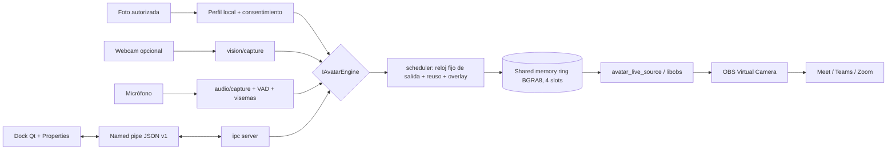

# Arquitectura — OBS Avatar Live 2.1

Contrato IPC exacto: [PROTOCOL.md](PROTOCOL.md). Esquema de configuración: [`contracts/config.schema.json`](../contracts/config.schema.json).

## 1. Vista general



## 2. Procesos

### Proceso A — plugin `obs-avatar-live.dll` (C++17, libobs)

- Registra `avatar_live_source` (`OBS_SOURCE_TYPE_INPUT`, video síncrono).
- **No ejecuta modelos ML.** Lanza `avatar-engine.exe` en un *Job Object* (el motor muere con OBS) y le pasa `--session`, `--parent-pid` y el token por variable de entorno.
- `video_tick`: lectura no bloqueante del ring (seqlock), copia del cuadro más reciente a un búfer privado, detección de cuadro obsoleto / motor sin latido.
- `video_render`: sube el búfer a una textura (creada en el contexto gráfico) y la dibuja. Si el cuadro es obsoleto muestra un estado visible de degradación, nunca la última cara indefinidamente.
- Hilo cliente IPC separado (named pipe) para comandos, métricas y eventos; reconexión y relanzamiento del motor (objetivo < 10 s).
- Dock opcional "Avatar Live Control" (solo hilo GUI); la fuente funciona sin Dock.

### Proceso B — `avatar-engine.exe` (Python, empaquetado con PyInstaller)

| Hilo | Responsabilidad |
|---|---|
| IPC server | Acepta un único cliente autenticado, despacha comandos, emite eventos `state`/`metrics`/`fallback`/`error`. |
| Captura de video | Webcam a 640×480/640×360/320×240; cola de 2, *drop-oldest*. |
| Captura de audio | 16 kHz mono, bloques de 20 ms; nunca persiste audio. |
| Motor | `IAvatarEngine` activo: detección/tracking, swap o rig 2D. |
| Scheduler | Reloj fijo de salida (30 FPS), toma el último resultado válido, marca `repeated`, aplica overlay y escribe en el ring. |
| Health / adaptive | Ventanas de métricas de 10–15 s, histéresis, fallback. |

Vigilancia del padre: si `--parent-pid` termina, el motor se cierra.

## 3. Contrato de motor

`engines/base.py` define `IAvatarEngine` (spec §4): `initialize`, `load_profile`, `start_session`,
`push_video`, `push_audio`, `set_expression`, `poll_frame`, `get_metrics`, `set_quality`,
`stop_session`, `shutdown`. `FrameDescriptor.generation_id` invalida cuadros de sesiones previas o de un
proveedor anterior tras un cambio.

## 4. Motores

| Id | Pipeline | Módulos |
|---|---|---|
| `lite_cpu_audio` | foto → detección offline → capas boca/ojos → visemas heurísticos + parpadeo no periódico + mirada + microgestos → BGRA | `engines/lite_cpu_audio.py`, `audio/vad.py`, `audio/visemes.py` |
| `lite_cpu_swap` | webcam → detector (YuNet, cada N cuadros) + tracking ROI → alineación 5 puntos → swap ONNX (128×128) → máscara suave → pegado | `engines/lite_cpu_swap.py`, `vision/*` |
| `lite_adaptive` | igual que `lite_cpu_swap` + `provider_probe` → `startup_benchmark` → selección → `adaptive_controller` | `engines/lite_adaptive.py`, `performance/*` |
| `accelerated_swap` | swap con CUDA/DirectML/OpenVINO, fallback CPU (experimental) | `engines/accelerated_swap.py` |
| `synthetic_head` | stub de Fase 4 | `engines/synthetic_head.py` |

La estimación de visemas es **heurística** (energía + rasgos espectrales simples). La energía RMS sola solo
aproxima apertura de boca y se usa como respaldo; no se presenta como reconocimiento de visemas.

## 5. Políticas de colas y temporización

- Adquisición nunca bloquea al compositor: cola de entrada 2, *drop-oldest*.
- Salida a reloj fijo; se reutiliza el último resultado (marcado `repeated`) y se informan por separado `face_swap_unique_fps`, `output_fps` y `repeated_frame_pct` (ADR-003).
- Cuadro con antigüedad > `stale_frame_ms` (500 ms por defecto) o backlog: se descartan cuadros antiguos y se marca `degraded`; el plugin muestra el estado.
- Búfer de audio de 40–100 ms para la boca, con desfase calibrable (`audio.mouth_delay_ms`).
- Timestamps monotónicos en el mismo reloj (QPC en Windows).

## 6. Lite Adaptive

```text
candidates = discover_supported_providers()            # disponibilidad ≠ funcionamiento
if cpu_only: candidates = [CPUExecutionProvider]        # no se inicializa ningún EP acelerado
results = [benchmark_with_warmup(ep) for ep in candidates]   # 8 s por defecto
viable = filter(correctness, memory, p95 <= max_latency)
selected = rank(unique_fps, latency, cpu_load).first_or_cpu()
```

- Resultados guardados en `%LOCALAPPDATA%\AvatarLive\benchmarks\` con clave hardware + driver + versión ORT + hash del modelo + resolución; se invalidan si cambia cualquiera.
- **Escalera de degradación** (histéresis de ≥3 ventanas, sin cambios a mitad de cuadro; drenar colas e incrementar `generation_id`):
  1. desactivar enhancer;
  2. detector 640 → 320 si mantiene detección;
  3. aumentar intervalo de detección y usar tracking;
  4. captura → 640×360 / 480;
  5. reducir tasa de inferencia manteniendo 30 FPS de salida con cuadros marcados como repetidos;
  6. ofrecer Lite CPU Audio o pausa visible.
- La recuperación (subir de nivel) usa la misma histéresis.

## 7. Seguridad del transporte

Named pipe con `PIPE_REJECT_REMOTE_CLIENTS` y DACL limitada al SID del usuario y SYSTEM; primer mensaje
`hello` con token aleatorio; mapeo de memoria `Local\` (sesión). Sin gRPC para cuadros en v1.

## 8. Decisiones registradas (ADR)

| ADR | Decisión |
|---|---|
| 001 | Plugin y motor en procesos separados; OBS no ejecuta inferencia pesada. |
| 002 | Ring de memoria compartida para video; named pipe para control. |
| 003 | Se distinguen FPS de salida y FPS de cuadros transformados. |
| 004 | Lite CPU tiene dos motores: audio sin cámara y swap con cámara. |
| 005 | Deep-Live-Cam es referencia de análisis; reutilizar solo tras resolver derechos de código y pesos (hoy: no se reutiliza código). |
| 006 | Etiquetado visible del contenido sintético en la salida. |
| 007 | Se usa OBS Virtual Camera; no se instala cámara virtual propia. |
| 008 | No fijar prestaciones de latencia hasta medirlas en hardware objetivo. |
| 009 | Lite Adaptive selecciona OpenVINO/DirectML/CPU validado por benchmark, sin GPU dedicada. |
| 010 | Se preserva CPU puro y se muestran por separado cuadros nuevos, repetidos y FPS de salida; degradación visible. |
